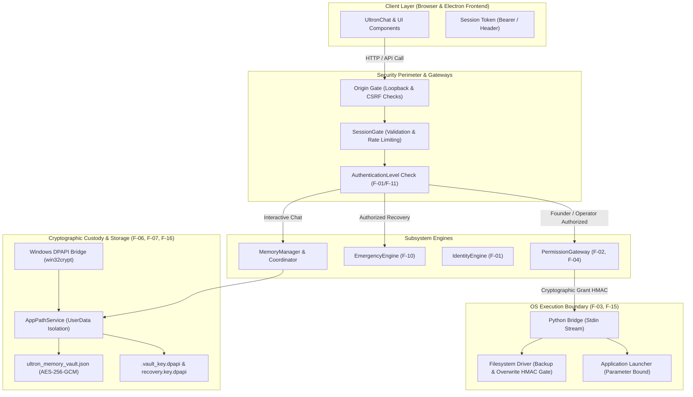

# ULTRON Phase 2 Architecture & Trust Boundaries

---

## Trust Boundaries & Security Enforcements

### 1. The Network / Client Boundary
- **Threat:** Malicious web page making cross-origin requests to local port 3000.
- **Defense:** Strict origin validation blocks non-loopback domains; `sec-fetch-site === "cross-site"` requests are rejected with HTTP 403 Forbidden.

### 2. The Identity & Role Boundary (F-01, F-11)
- **Threat:** Normal loopback bootstrap session attempting to approve privileged OS actions without biometric founder authorization.
- **Defense:** Bootstrap session is locked to `userRole: "operator"` and `authenticationLevel: "CHAT_AUTHENTICATED"`. Approving execution plans on `/api/permission` requires `founder` or elevated role.

### 3. The Execution Boundary (F-03, F-15)
- **Threat:** Internal Node.js or compromised code calling Python driver directly to overwrite files or launch arbitrary commands.
- **Defense:** Python bridge verifies cryptographic execution grant tokens containing SHA-256 parameter hashes, strict TTL, and HMAC signatures.

### 4. The Key Custody Boundary (F-06, F-07, F-16)
- **Threat:** Untrusted non-elevated process reading plaintext keys from disk.
- **Defense:** Keys are protected via Windows DPAPI (`CryptProtectData`), binding secrets to the user's logon session and machine TPM.
