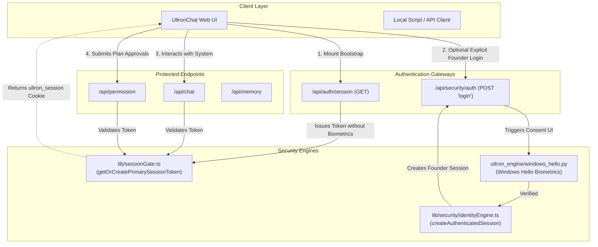
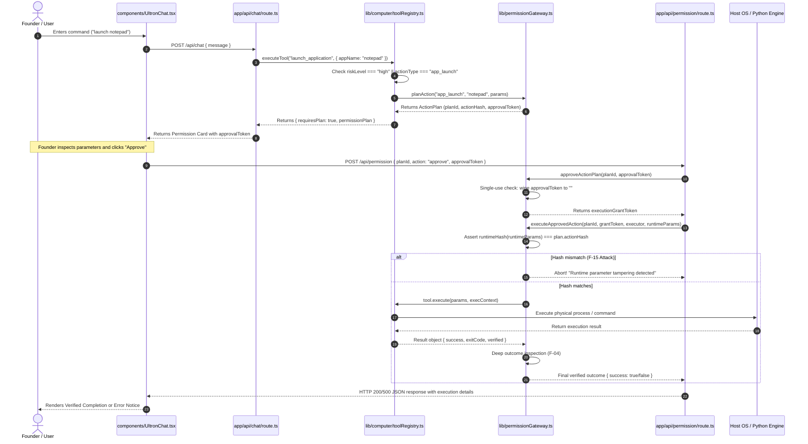

# ULTRON Security Call Graph & Trust Boundaries

**Repository:** `https://github.com/ashish7802/ultron`  
**Audit Baseline Commit:** `fbd89a672e71a405e9eeae5f6863ac4248ea3760`  
**Working Branch:** `fix/phase1-security-invariants`  
**Date:** 2026-11-14

---

## 1. Authentication & Session Trust Boundary



### Architectural Finding (F-01 Trust Boundary)
- **Primary Chat & Computer Route Gate:** Protected by `sessionGate.ts:validateDesktopSession()`. This requires loopback origin, anti-CSRF headers, and a valid `ultron_session` cookie issued via `/api/auth/session` (bootstrap).
- **Founder Identity Gate:** Windows Hello biometrics are enforced on `/api/security/auth` (and sensitive security vault unlocks). However, chat interactions and computer action execution do NOT require Windows Hello biometrics on every startup; loopback session bootstrap grants access to `/api/chat` and `/api/permission`.

---

## 2. Action Authorization & Execution Lifecycle (F-02, F-04, F-15)



---

## 3. Cryptographic Subprocess File Overwrite Boundary (F-03)

```mermaid
flowchart LR
    subgraph TypeScript Core
        TR[toolRegistry.ts]
        PG[permissionGateway.ts]
        FSI[fileSystemIntelligence.ts]
        PB[pythonBridge.ts]
    end

    subgraph Native Python Process
        CLI[computer_intelligence_cli.py]
        FSD[filesystem_driver.py]
        VAULT[(recovery.key in .security_vault)]
        NONCES[(.consumed_grants.log)]
    end

    subgraph Host Filesystem
        TARGET_FILE[(Target Physical File)]
        BACKUP[(backups/filesystem/*.bak)]
    end

    TR -->|1. Overwrite Requested| PG
    PG -->|2. Generate HMAC Grant| PG
    PG -->|3. { token: planId|op|path|exp|nonce|sig }| TR
    TR -->|4. writeFile(path, content, overwrite, grant)| FSI
    FSI -->|5. JSON Payload via Stdin| PB
    PB -->|6. Spawns Subprocess| CLI
    CLI -->|7. write_file(path, content, grant)| FSD
    
    FSD -->|8. Read Founder Secret| VAULT
    FSD -->|9. Verify HMAC-SHA256 & Canonical Path| FSD
    FSD -->|10. Check Nonce not in| NONCES
    
    alt Grant Invalid / Spoofed Boolean
        FSD -->|BLOCKED| CLI
        CLI -->|Error JSON| PB
    else Grant Authenticated
        FSD -->|11. Create Rolling Backup| BACKUP
        FSD -->|12. Commit Atomic Write| TARGET_FILE
        FSD -->|13. Record Nonce| NONCES
        FSD -->|14. Success JSON| CLI
    end
```

---

## 4. Key Storage & Encryption Trust Boundaries (F-06, F-08, F-16)

| Asset / Storage Path | Storage Format | Encryption / Protection | Threat Boundary & Access Rules |
| :--- | :--- | :--- | :--- |
| `.vault_key` | Raw 64-char Hex (UTF-8) | **None** (Filesystem ACLs only) | Readable by any process running as the current Windows user. Not DPAPI-encrypted in TypeScript. |
| `.security_vault/recovery.key` | Raw 64-char Hex (UTF-8) | **None** (0600 mode on Unix; normal ACL on Windows) | Plaintext founder recovery key. Used for HMAC-SHA256 signing of subprocess grants and emergency recovery. |
| `ultron_memory_vault.json` | AES-256-GCM Envelope | Key derived from `.vault_key` or `ULTRON_MASTER_KEY` | Encrypted at rest. However, any local process under same user can read `.vault_key` and decrypt the vault. |
| `ultron_engine/secure_vault.py` | Binary (`vault.bin`) | **Windows DPAPI** (`win32crypt`) | Used by Python engine for OS-bound key storage. Distinct from Node.js `.vault_key`. |
| Legacy Fallback Key | Static String in Code | Hardcoded in `lib/crypto.ts` | Dead code in new writes, but exists in fallback decryption branches for legacy migration. |
