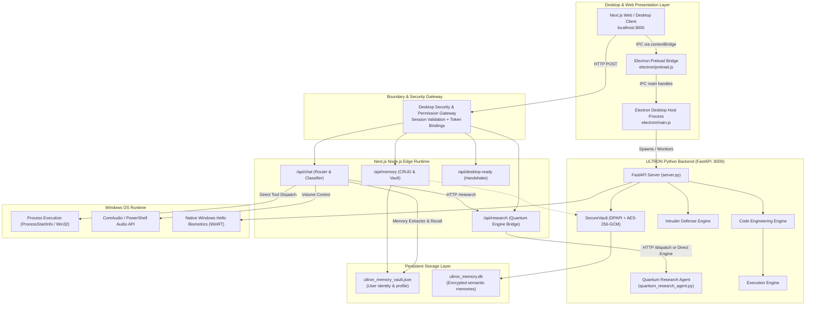

# ULTRON Architectural Map & Dataflow Analysis

## Executive Summary
This document outlines the complete architectural topology, trust boundaries, subsystem communications, and data flows of the ULTRON desktop AI system.



---

## 1. Subsystem Breakdown

### 1.1 Presentation Layer (Electron & Next.js)
- **Electron Main Process (`electron/main.js`):**
  - Manages browser window lifecycle, IPC handlers (`app-version`, `platform`, `system-info`, `check-desktop-ready`).
  - Launches and monitors background daemons (Next.js server and Python engine via `electron/serverStartup.js`).
  - Enforces single instance locks and desktop window borders.
- **Electron Preload (`electron/preload.js`):**
  - Exposes safe `window.ultronDesktop` APIs via `contextBridge.exposeInMainWorld`.
  - Blocks direct access to Node.js primitives (`child_process`, `fs`, `net`).
- **Next.js Frontend (`app/page.tsx`, `components/*`):**
  - Cyberpunk-styled React UI built with Tailwind CSS.
  - Interactive multi-turn chat interface with live voice transcription and model responses.
  - Streaming audio visualizer and memory vault panel.

### 1.2 Orchestration & API Routes
- **`app/api/chat/route.ts`:**
  - Ingestion gateway for user messages.
  - Classifies queries into Deterministic Rules (Greetings, Identity, Math, System Telemetry), Desktop Actions (App Launcher, Browser URL, Audio Volume), Quantum Research, or Local LLM (Ollama).
  - Handles real-time Hinglish / Multilingual response synthesis.
- **`app/api/memory/route.ts`:**
  - CRUD endpoint for persistent user facts.
  - Integrates `lib/memoryManager.ts` to sync profile facts.
- **`app/api/research/route.ts`:**
  - Next.js wrapper communicating with local Python research agent on `http://127.0.0.1:8000/research` or local fallback.
- **`app/api/desktop-ready/route.ts`:**
  - Health check endpoint signaling when both frontend and Python backend are ready.

### 1.3 Local Python Engine (`ultron_engine/`)
- **FastAPI Core (`ultron_engine/server.py`):**
  - Listens on `http://127.0.0.1:8000`.
  - Routes: `/health`, `/research`, `/dispatch`, `/engine/{name}/process`, `/hello/authenticate`.
- **Quantum Research Agent (`ultron_engine/quantum_research_agent.py`):**
  - Multi-hypothesis exploratory search system using DuckDuckGo HTML scraping, DNS pinning, and SSRF filtering.
  - Quantum superposition scoring algorithm for ranking search evidence.
- **Secure Vault (`ultron_engine/secure_vault.py` & `crypto.py`):**
  - SQLite database encrypted using Windows DPAPI protected AES-256-GCM.
- **Intruder Defense (`ultron_engine/intruder_defense.py`):**
  - Brute force lockout, threat scoring, and forensic snapshot capture.
- **Specialized Engines (`ultron_engine/engines/`):**
  - `code_engineering.py`: Code analysis, syntax checking, and safe script generation.
  - `execution.py`: Sandboxed script execution.
  - `memory.py`: Semantic memory graph and similarity matching.

---

## 2. Trust Boundaries & Security Zones

| Boundary | Components Involved | Current Security Control | Remediation Requirement |
|---|---|---|---|
| **Boundary 1: Local Browser to Next.js API** | Chrome / Edge to `http://localhost:3000/api/*` | None (Unauthenticated loopback) | Add Local Desktop Session Gate (`X-ULTRON-Session-Token` & Origin validation) |
| **Boundary 2: Next.js API to Python Engine** | Next.js server to `http://127.0.0.1:8000/*` | Shared secret header `X-Ultron-Secret` | Replace hardcoded token with cryptographically random IPC handshake token |
| **Boundary 3: User Request to OS Action** | `app/api/chat/route.ts` to Windows OS | Soft heuristic check | Strict Universal Computer Action Permission Gateway |
| **Boundary 4: Memory Ingestion to Disk** | UI / API to `ultron_memory_vault.json` | Plain JSON file read/write | Consolidated authenticated encrypted memory vault |
| **Boundary 5: External Web to Research Engine** | DuckDuckGo to `quantum_research_agent.py` | DNS Pinning & SSRF validation | Strict prompt injection encapsulation (`<untrusted_web_content>`) |

---

## 3. Data Flow Pathways

### 3.1 Chat & Desktop Command Pathway
```
User (UI) 
  --> [X-ULTRON-Session validation]
  --> /api/chat
  --> Regex / Intent Classifier
  --> [If OS Action] --> Universal Permission Gateway (Plan -> Validate -> Prompt Approval -> Hash Verification -> Execute)
  --> [If Research] --> Python Quantum Research Agent (/research)
  --> [If Conversational] --> Memory Context Injection + Ollama LLaMA 3.2
  --> Response Synthesis (Hinglish / Language Adaptation)
  --> Memory Extractor (Save user facts)
  --> UI Render
```

### 3.2 Persistent Memory Flow
```
User Message ("I am Ashish")
  --> Memory Manager extractAndPersistFacts()
  --> Filters pronouns & stopwords
  --> Updates memory profile in ultron_memory_vault.json
  --> Syncs to SecureVault (AES-256-GCM encrypted database)
```
