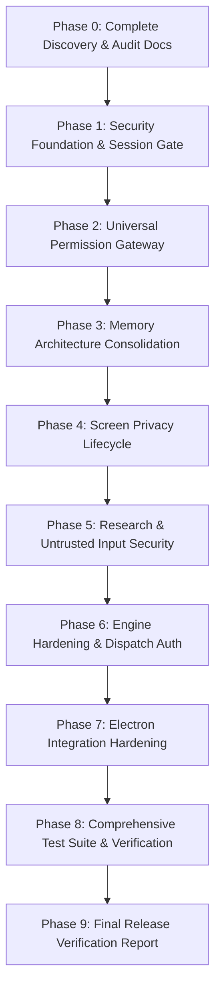

# ULTRON Remediation Plan & Execution Roadmap

This plan defines the step-by-step remediation procedure to resolve all security, architectural, and reliability issues identified in `docs/audit/SECURITY_FINDINGS.md`.

---

## 1. Remediation Principles & Rules of Engagement

1. **Rule 14 Gate (Absolute Rule)**: NEVER commit, merge, or push to the `main` branch without explicit user authorization. All work is isolated in `remediation/security-and-reliability`.
2. **Rule 15 Data Preservation**: Under no circumstances will user memories in `ultron_memory_vault.json` (Ashish's profile) be deleted or overwritten. Automatic backup is created before any migration.
3. **Fail-Closed Security**: Every boundary must default to denying access if authentication or authorization credentials are missing or corrupted.
4. **Zero Paid APIs**: Maintain 100% functionality with local Ollama, Windows DPAPI, and free/local services.
5. **No Regressions**: Every phase must pass full unit, security, and integration test suites before proceeding.

---

## 2. Phased Implementation Roadmap

### Phase 1: Security Foundation
- **Goals**:
  - Implement Local Desktop Session Gate (`lib/sessionGate.ts`) for Next.js API routes (`/api/chat`, `/api/memory`, `/api/research`).
  - Validate Origin (`localhost:3000`, `127.0.0.1:3000`) and enforce `X-ULTRON-Session-Token`.
  - Remove hardcoded secret `DEFAULT_KEY_STRING` in `lib/crypto.ts` and `ultron_engine/server.py`.
  - Wire failed authentications into `IntruderDefense`.
- **Artifacts**: `lib/sessionGate.ts`, updated `lib/crypto.ts`, updated `app/api/chat/route.ts`, updated `app/api/memory/route.ts`.
- **Verification Gate**: `tests_auth_boundary.test.mjs` passes.

### Phase 2: Universal Computer Action Permission Gateway
- **Goals**:
  - Implement `lib/permissionGateway.ts` adhering to the complete execution lifecycle:
    `PLAN -> VALIDATE -> PRESENT ACTION -> REQUEST APPROVAL -> VERIFY APPROVAL -> EXECUTE -> VERIFY RESULT -> AUDIT LOG`.
  - Intercept application launches, URL browser navigation, and audio volume commands.
  - Require cryptographically bound, single-use, time-expiring approval tokens (`nonce + action_hash + expiry`).
  - Update chat route to return a permission request structure rather than auto-executing OS actions.
- **Artifacts**: `lib/permissionGateway.ts`, updated `lib/appLauncher.ts`, updated `lib/systemController.ts`.
- **Verification Gate**: `tests_permission_gateway.test.mjs` passes.

### Phase 3: Memory Architecture Consolidation
- **Goals**:
  - Backup `ultron_memory_vault.json` to `ultron_memory_vault.json.bak`.
  - Consolidate TypeScript memory manager with authenticated, encrypted storage at rest (AES-256-GCM).
  - Provide automatic transparent migration of existing records without losing user name ("Ashish") or project facts.
  - Add request size limits, ownership verification, and schema validation on `/api/memory`.
- **Artifacts**: `lib/memoryManager.ts`, `lib/encryptedStorage.ts`.
- **Verification Gate**: `tests_memory_consolidation.test.mjs` passes.

### Phase 4: Screen Awareness Privacy & Lifecycle
- **Goals**:
  - Implement `lib/screenPrivacyController.ts`.
  - Enforce explicit state: OFF by default.
  - Require explicit user consent per capture session and maintain a window exclusion list (password managers, banking apps).
  - Fail-closed: return empty capture with audit log if session is unapproved.
- **Artifacts**: `lib/screenPrivacyController.ts`.
- **Verification Gate**: `tests_screen_privacy.test.mjs` passes.

### Phase 5: Research & Untrusted Input Security
- **Goals**:
  - Encapsulate all scraped DuckDuckGo web content inside `<untrusted_web_content>` XML tags in `ultron_engine/quantum_research_agent.py`.
  - Instruct the model with strict delimiters to ignore adversarial instructions embedded within web pages.
  - Replace hardcoded `0.99` confidence in `app/api/chat/route.ts` with authentic source credibility metrics.
- **Artifacts**: updated `ultron_engine/quantum_research_agent.py`, updated `app/api/chat/route.ts`.
- **Verification Gate**: `tests_research_injection.py` passes.

### Phase 6: Engine Hardening & Dispatch Auth
- **Goals**:
  - Enforce authentication on FastAPI endpoints `/dispatch` and `/engine/{name}/process`.
  - Restrict shell command execution in `ultron_engine/engines/code_engineering.py` and `execution.py` to allow-listed binaries.
- **Artifacts**: updated `ultron_engine/server.py`, `ultron_engine/engines/code_engineering.py`.
- **Verification Gate**: `tests_engine_dispatch_auth.py` passes.

### Phase 7: Electron Integration Hardening
- **Goals**:
  - Verify context isolation and sandbox in `electron/main.js` and `electron/preload.js`.
  - Ensure IPC channels use strict input validation and do not expose raw shell execution.
  - Coordinate session token distribution from Electron main to the desktop webview.
- **Artifacts**: updated `electron/main.js`, `electron/preload.js`.
- **Verification Gate**: `tests_electron_startup.test.mjs` passes.

### Phase 8: Comprehensive Regression & Reliability Verification
- **Goals**:
  - Run all Node.js and Python test suites.
  - Execute full production build: `npm run build:next`.
  - Run TypeScript type checks (`npx tsc --noEmit`) and ESLint.
- **Artifacts**: Test execution logs and reports.
- **Verification Gate**: 100% test pass rate with 0 build errors.

### Phase 9: Documentation & Release Preparation
- **Goals**:
  - Compile final verification summary and remediation report.
  - Verify working tree is clean.
  - Await explicit user authorization before opening pull request or merging to `main`.
