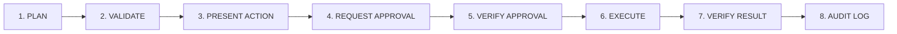

# ULTRON Universal Computer Action Permission Gateway

## Core Security Policy
**NO OS, APPLICATION, FILE, DATABASE, OR EXTERNAL-SYSTEM ACTION MAY EXECUTE WITHOUT EXPLICIT USER APPROVAL.**

Autonomous execution of operating system commands, application launches, or browser navigation is strictly prohibited. The system enforces an immutable, cryptographic execution lifecycle.

---

## 1. Execution Lifecycle

### Phase Details

1. **PLAN (`planAction`):**
   - Captures the exact action type, target binary/URL/file, and parameter map.
   - Computes canonical SHA-256 `actionHash` over normalized parameters.
   - Evaluates risk level (`low`, `medium`, `high`, `critical`) and generates human-readable risk explanation.
   - Generates unique `planId` and cryptographic `approvalToken`.
   - Sets 5-minute expiration timer.

2. **VALIDATE:**
   - Evaluates binary against allowlists.
   - Validates paths against project boundaries (prevents directory traversal).

3. **PRESENT ACTION & REQUEST APPROVAL:**
   - Displays action plan in UI:
     - Exact target application or command.
     - Affected resources (e.g. `["Google Chrome", "Windows Desktop Session"]`).
     - Meaningful risk explanation.
     - Approval and Cancel actions.

4. **VERIFY APPROVAL (`approveActionPlan`):**
   - Validates `approvalToken` presented by user.
   - Checks plan expiration (5-minute TTL).
   - Generates a single-use `executionGrantToken`.

5. **EXECUTE (`executeApprovedAction`):**
   - Re-computes SHA-256 hash of parameters to detect post-approval tampering.
   - Immediately consumes and revokes the `executionGrantToken` (anti-replay guarantee).
   - Dispatches execution to the physical OS API.

6. **VERIFY RESULT & AUDIT LOG:**
   - Verifies process exit code or outcome.
   - Appends entry to `docs/audit/GATEWAY_AUDIT_LOG.json` omitting credentials and secrets.

---

## 2. Risk Matrix

| Action Type | Examples | Default Risk | Justification |
|---|---|---|---|
| `app_launch` | Notepad, Chrome | Medium | Spawns a host desktop process in the user session. |
| `app_launch` (Shell) | cmd.exe, powershell.exe | Critical | Interactive or administrative command shell. |
| `browser_open` | https://youtube.com | Low | Navigates default browser to external URL. |
| `volume_change` | Volume Up / Down / Mute | Low | Dispatches virtual keyboard audio simulation. |
| `file_delete` | Remove file or folder | Critical | Irreversible loss of host data. |
| `file_write` | Overwrite file content | High | Modifies disk records. |
